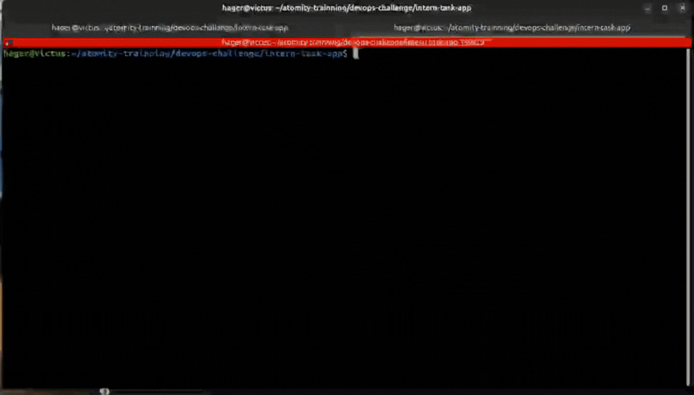
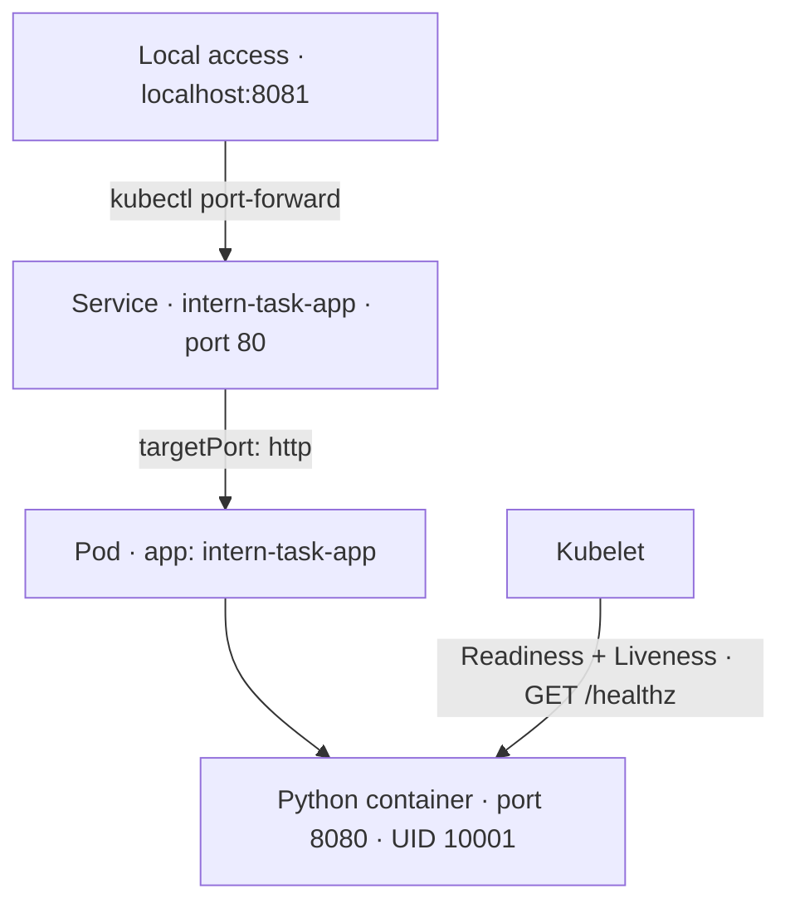
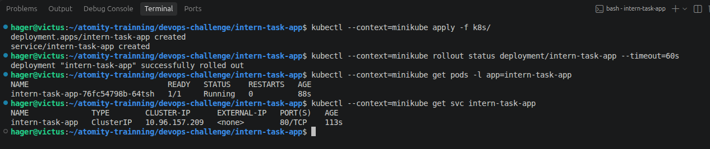
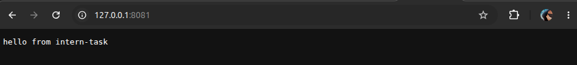

# Python App → Docker → Kubernetes

**Non-root container · Local image · Health probes · Verified recovery**

[▶ Watch the short demo]



A dependency-free Python service, packaged with Docker and verified on Minikube.

## Request Flow



## Why These Choices?

| Decision | Purpose |
|---|---|
| `python:3.12-slim` | A compact Python runtime; no external packages needed. |
| Single-stage build | No compilation or build dependencies to separate. |
| Non-root · UID `10001` | Runs without unnecessary root privileges. |
| `imagePullPolicy: Never` | Uses the locally loaded image without registry pulls. |
| HTTP readiness & liveness | Detects an unresponsive server and enables recovery. |

**Traffic:** localhost `8081` → Service `80` → application `8080`

## Verified Behavior

| Test | Result |
|---|---|
| Manifest validation | Accepted by the Kubernetes API |
| Deployment | Rolled out successfully · Pod ready |
| `GET /` | `200 OK` · `hello from intern-task` |
| `GET /healthz` | `200 OK` · `ok` |
| Runtime identity | `appuser` · UID `10001` |
| Controlled failure | Probe timeouts detected; container restarted and returned to Ready |

Failure was injected using an incomplete HTTP request to block the single-threaded server.

## Run It Yourself

Requires Docker, Minikube, and kubectl. From `intern-task-app/`:

```bash
docker build -t intern-task-app:local .
minikube start -p minikube
minikube -p minikube image load intern-task-app:local

kubectl --context=minikube apply -f k8s/
kubectl --context=minikube rollout status deployment/intern-task-app --timeout=60s
kubectl --context=minikube port-forward svc/intern-task-app 8081:80
```

In another terminal:

```bash
curl -fsS http://127.0.0.1:8081/healthz
curl -fsS http://127.0.0.1:8081/
```

Local port `8081` avoids an existing host-port conflict.

## In Action

**Deployment ready**



<details>
<summary>View HTTP responses</summary>

**Application**



**Health check**


</details>