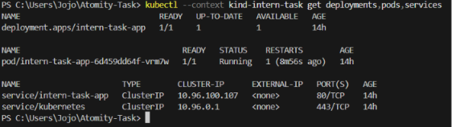
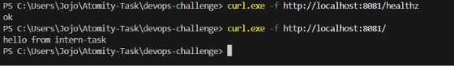

# Task 1: Application deployment and verification

## Implementation choices

- Used `python:3.12-slim` because the application only requires Python's standard library.
- Kept the application listening on port 5000.
- Used `imagePullPolicy: Never` because the image is built locally and loaded into kind, rather than published to a registry.
- Configured readiness and liveness probes against `/healthz` on port 5000.
- Readiness checks determine whether the Pod can receive Service traffic. Repeated liveness failures cause the container to restart.
- Configured the Service to expose port 80 and forward to application port 5000.

## Reproduce on a fresh local cluster

With Docker Desktop running, execute these commands from `intern-task-app`:

```powershell
docker build -t intern-task-app:local .
kind create cluster --name intern-task
kind load docker-image intern-task-app:local --name intern-task
kubectl --context kind-intern-task apply -f k8s/
kubectl --context kind-intern-task rollout status deployment/intern-task-app --timeout=60s
kubectl --context kind-intern-task get deployments,pods,services
kubectl --context kind-intern-task port-forward svc/intern-task-app 8081:80
```

Leave port-forward running. In another terminal:

```powershell
curl.exe -f http://localhost:8081/healthz
curl.exe -f http://localhost:8081/
```

Local port 8081 was used because port 8080 was already occupied.

## Observed results

- Docker image built successfully.
- The application also ran successfully as a standalone Docker container.
- Kubernetes Deployment rolled out successfully and showed 1/1 ready.
- The Pod showed 1/1 Running.
- `/healthz` returned `ok`.
- `/` returned `hello from intern-task`.
- Both endpoints were checked again successfully after restarting Docker Desktop.

## Verification screenshots

### Kubernetes resources



### Application endpoints

