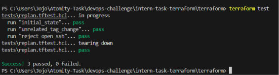
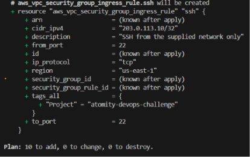

# Task 2: Terraform infrastructure and CI verification

## Scope

This configuration describes an AWS deployment of the Task 1 application. No AWS resources were deployed. Local planning uses fake credentials, and the automated tests use a mocked AWS provider.

## Infrastructure choices

- Configured a VPC, public subnet, internet gateway, default internet route, and route-table association.
- Configured one EC2 instance with a public IP.
- Restricted the security group's SSH rule to the required `ssh_cidr` input.
- Allowed application traffic on TCP port 5000.
- Added input validation that rejects invalid IPv4 CIDRs and unrestricted `/0` SSH networks.
- Required IMDSv2 and configured an encrypted gp3 root volume.
- Added outputs for the instance public IP and application port.

## Startup configuration

The user-data template:

- Creates a non-root host user with passwordless sudo.
- Installs and starts Docker.
- Embeds the exact Dockerfile and Python source from Task 1.
- Builds the application image using that Dockerfile.
- Enables a systemd-managed container that starts after reboot.
- Configures the host firewall to deny incoming traffic except application port 5000.
- Checks the application's health endpoint after starting the service.

The container uses Linux host networking so application traffic is subject to the host firewall.

The host firewall follows the README's application-port-only wording. Consequently, the security group's restricted SSH rule does not make SSH reachable through the host firewall.

## User-data lifecycle

The startup script is rendered deterministically, with Linux line endings.

The instance uses:

```hcl
lifecycle {
  ignore_changes = [user_data]
}
```

This treats user data as first-boot configuration and ignores later changes to that attribute on an existing instance.

The trade-off is that editing the startup script or embedded application does not update an existing instance. Such updates would require deliberate replacement or another deployment mechanism.

A mocked test creates simulated state, changes an unrelated instance tag, and verifies that the subsequent plan preserves the existing mocked instance ID.

## CI workflow repairs

The workflow changes are separate from the infrastructure implementation:

1. Set the working directory to `intern-task-terraform/terraform`.
2. Added initialization before validation.
3. Included the workflow's own file in the trigger path filters.
4. Included the Task 1 Dockerfile and application source because Terraform embeds them.
5. Enabled checks on relevant feature-branch pushes.
6. Matched Terraform to the locally tested version.
7. Limited repository permissions to read access and added a job timeout.

The workflow runs formatting, initialization, and validation. Local planning and mocked tests provide additional checks.

## Reproduce locally

Run these commands in PowerShell from `intern-task-terraform/terraform`:

```powershell
terraform init
terraform fmt -check -recursive
terraform validate

$env:AWS_ACCESS_KEY_ID = "fake"
$env:AWS_SECRET_ACCESS_KEY = "fake"
$env:AWS_DEFAULT_REGION = "us-east-1"
$env:AWS_EC2_METADATA_DISABLED = "true"
$env:TF_VAR_ssh_cidr = "203.0.113.10/32"

terraform plan '-input=false' '-out=baseline.tfplan'
terraform test
```

The SSH address is a documentation example for local verification.

The test file uses `mock_provider "aws"`. Its initial `command = apply` creates simulated state only; it does not deploy infrastructure. No real `terraform apply` was run.

## Observed results

| Check | Result |
| --- | --- |
| Initialization | Passed |
| Formatting | Passed |
| Configuration validation | Passed |
| Plan with fake credentials | 10 to add, 0 to change, 0 to destroy |
| Mocked initial state | Passed |
| Plan after unrelated tag change | Passed; mocked instance ID preserved |
| Rejection of unrestricted SSH | Passed |
| Test summary | 3 passed, 0 failed |
| Bash syntax check of a local rendering of the startup template | Passed; startup commands were not executed |

Tested with Terraform 1.16.2 and AWS provider 6.73.0.

## Verification limits

No live EC2 boot, host firewall behavior, or reboot was tested. The startup script assumes Ubuntu with apt and systemd. The example AMI's current availability was not checked because the challenge does not require deployment.

## Verification screenshots

### Configuration validation and mocked tests



### Terraform plan

